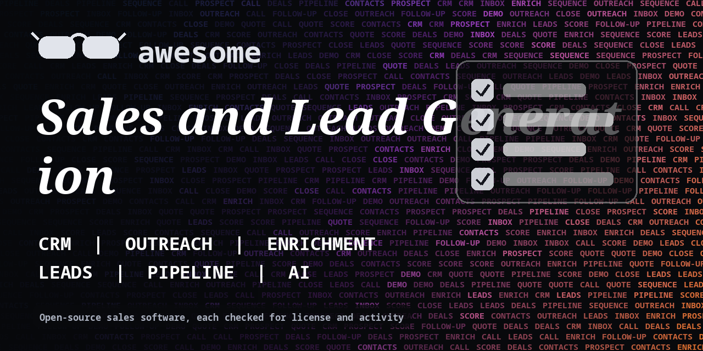

<h1 align="center">Awesome Sales and Lead Generation</h1>

> Open-source CRM, outreach, enrichment, scraping and pipeline tools for sales teams and solo founders. Every entry shows its license.

**Rules of this list:** every repo exists, is public, is not archived, states a license and has had a commit in the last year. One plain sentence each. Star counts and claims are the authors' own, we did not test every tool. Checked 2026-10-18. See [CONTRIBUTING.md](CONTRIBUTING.md).

## Contents

- [CRM](#crm)
- [Outreach and sequences](#outreach-and-sequences)
- [Lead finding and scraping](#lead-finding-and-scraping)
- [Enrichment and verification](#enrichment-and-verification)
- [Quotes, proposals and contracts](#quotes-proposals-and-contracts)
- [Booking and meetings](#booking-and-meetings)
- [AI for sales](#ai-for-sales)
- [Pipeline analytics](#pipeline-analytics)
- [How to choose](#how-to-choose)
- [Contributing](#contributing)

## CRM

Contacts, deals and pipelines.

- [espocrm/espocrm](https://github.com/espocrm/espocrm)  - Open-source CRM platform you can self-host. _(AGPL-3.0)_
- [frappe/crm](https://github.com/frappe/crm)  - Open-source CRM built on the Frappe framework. _(AGPL-3.0)_
- [krayin/laravel-crm](https://github.com/krayin/laravel-crm)  - Open-source CRM built on Laravel. _(MIT)_
- [monicahq/monica](https://github.com/monicahq/monica)  - Personal CRM to remember details about people you know. _(AGPL-3.0)_
- [odoo/odoo](https://github.com/odoo/odoo)  - Open-source business apps with a CRM module. _(check repo)_
- [SuiteCRM/SuiteCRM](https://github.com/SuiteCRM/SuiteCRM)  - Open-source CRM for sales, marketing and support. _(AGPL-3.0)_
- [twentyhq/twenty](https://github.com/twentyhq/twenty)  - Modern open-source CRM, a community alternative to Salesforce. _(check repo)_

## Outreach and sequences

Cold and warm email, calling and follow-ups. Follow anti-spam law.

- [activepieces/activepieces](https://github.com/activepieces/activepieces)  - No-code automation for lead and email workflows. _(check repo)_
- [knadh/listmonk](https://github.com/knadh/listmonk)  - Self-hosted newsletter and mailing list manager. _(AGPL-3.0)_
- [mautic/mautic](https://github.com/mautic/mautic)  - Open-source marketing automation for email, forms and campaigns. _(check repo)_
- [n8n-io/n8n](https://github.com/n8n-io/n8n)  - Workflow automation to build outreach and lead routing flows. Fair-code license. _(check repo)_
- [postalserver/postal](https://github.com/postalserver/postal)  - Open-source mail delivery platform. _(MIT)_

## Lead finding and scraping

Find public business data. Check each source's terms.

- [apify/crawlee](https://github.com/apify/crawlee)  - Web scraping and crawling library for Node.js. _(Apache-2.0)_
- [laramies/theHarvester](https://github.com/laramies/theHarvester)  - Gather public emails, subdomains and names for reconnaissance. _(GPL-2.0)_
- [scrapy/scrapy](https://github.com/scrapy/scrapy)  - Fast Python framework for crawling and extracting data from sites. _(BSD-3-Clause)_
- [sherlock-project/sherlock](https://github.com/sherlock-project/sherlock)  - Find usernames across social networks. _(MIT)_
- [soxoj/maigret](https://github.com/soxoj/maigret)  - Collect public profile information by username. _(MIT)_

## Enrichment and verification

Check emails and fill in company data.

- [mailcheck/mailcheck](https://github.com/mailcheck/mailcheck)  - Small library that suggests fixes for mistyped email domains. _(MIT)_
- [python-validators/validators](https://github.com/python-validators/validators)  - Python data validation for emails, URLs, IPs and more. _(MIT)_

## Quotes, proposals and contracts

Send documents and get them signed.

- [documenso/documenso](https://github.com/documenso/documenso)  - Open-source document signing platform. _(AGPL-3.0)_
- [docusealco/docuseal](https://github.com/docusealco/docuseal)  - Open-source document filling and signing. _(AGPL-3.0)_
- [invoiceninja/invoiceninja](https://github.com/invoiceninja/invoiceninja)  - Invoicing, quotes and payments for small businesses. _(check repo)_
- [InvoiceShelf/InvoiceShelf](https://github.com/InvoiceShelf/InvoiceShelf)  - Open-source invoicing app, continuation of Crater. _(AGPL-3.0)_

## Booking and meetings

Let prospects book time.

- [alextselegidis/easyappointments](https://github.com/alextselegidis/easyappointments)  - Self-hosted appointment scheduler. _(GPL-3.0)_
- [calcom/cal.diy](https://github.com/calcom/cal.diy)  - Open-source scheduling infrastructure, an alternative to Calendly. _(MIT)_
- [chatwoot/chatwoot](https://github.com/chatwoot/chatwoot)  - Open-source customer messaging platform with live chat and inbox. _(check repo)_

## AI for sales

SDR agents and call analysis. Always review before sending.

- [ggml-org/whisper.cpp](https://github.com/ggml-org/whisper.cpp)  - Fast local transcription in C and C++. _(MIT)_
- [langchain-ai/langchain](https://github.com/langchain-ai/langchain)  - Framework for building applications with language models. _(MIT)_
- [openai/whisper](https://github.com/openai/whisper)  - General-purpose speech recognition model, useful for call transcripts. _(MIT)_

## Pipeline analytics

Forecast and report.

- [apache/superset](https://github.com/apache/superset)  - Data exploration and dashboard platform. _(Apache-2.0)_
- [getredash/redash](https://github.com/getredash/redash)  - Connect to your data sources, query and share dashboards. _(BSD-2-Clause)_
- [grafana/grafana](https://github.com/grafana/grafana)  - Dashboards for metrics and data. _(AGPL-3.0)_
- [metabase/metabase](https://github.com/metabase/metabase)  - Business intelligence and dashboards for your data. _(check repo)_
- [PostHog/posthog](https://github.com/PostHog/posthog)  - Product analytics, session replay and feature flags. _(check repo)_

## How to choose

- **Follow anti-spam law.** CAN-SPAM, GDPR and similar rules apply to outreach.
- **Scraped data has terms.** Check the source's terms and your local privacy law.
- **Warm up sending domains** and keep lists clean.
- **Review AI messages** before they go out under your name.

## Contributing

See [CONTRIBUTING.md](CONTRIBUTING.md). One entry per pull request, plain words, real sources only.

## About

Maintained by [@devanasolver](https://github.com/devanasolver). Listings follow the rules in CONTRIBUTING.

## Sponsor me

If this list is useful, [buy me a coffee](https://buymeacoffee.com/isaac49).
